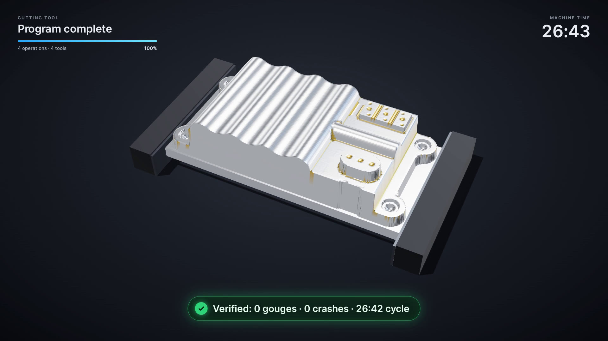
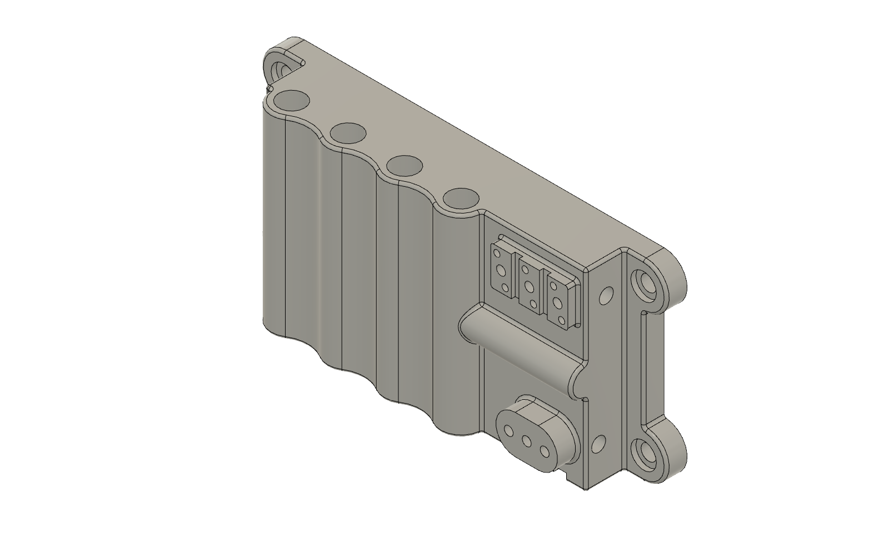
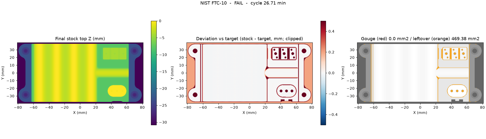
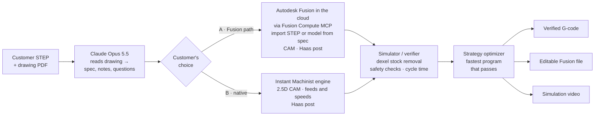
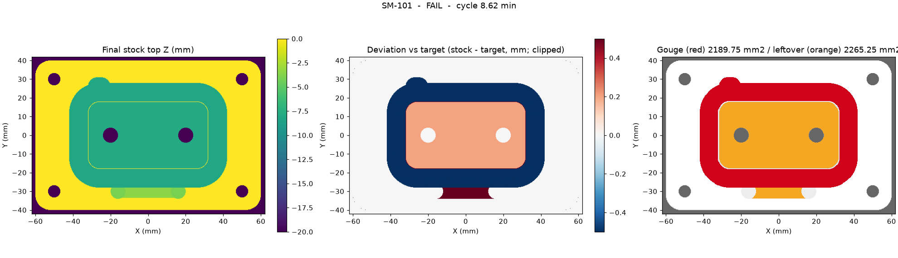

# Instant Machinist

**Customer STEP and drawing in, verified CNC program out in minutes.** Claude Opus 5.5 reads the
drawing. Instant Machinist then programs the part, either by driving Autodesk Fusion in the cloud or
with its own CAM engine. Our simulator proves every program before a machinist sees it, and our
optimizer keeps the fastest one that passes.

**[Demo video and stills → docs/demo.md](docs/demo.md)**

---

## The problem

- **16,876 machine shops** in the US, and **83 % of them have fewer than 20 employees**
  (2022 Economic Census, cited in a16z's
  [*The Case for the American Manufacturing Asset Class*](https://a16z.com/the-case-for-the-american-manufacturing-asset-class/)).
  Shops this size rarely have a dedicated CAM programming team, so programming competes with
  quoting, setup and running machines.
- **Every new part needs a CNC program: about 1–4 hours of skilled programmer time** ([CloudNC](https://www.cloudnc.com/blog/cam-assist-beta-feedback): ~1 h for a simple 3-axis part; [Modern Machine Shop](https://www.mmsonline.com/articles/automating-part-programming-cuts-the-time-to-engaging-work): 4–8 h for a complex one)
  before the spindle turns. In a high-mix job shop that happens for every new order.
- Programs written under time pressure are cautious: light cuts and book feeds. The machine pays for
  that on every part of the order.

## Headline result: NIST FTC-10 housing



The customer sends what shops really receive: a **STEP model** and a **5-page GD&T drawing** of the
[NIST PMI test case FTC-10](https://www.nist.gov/ctl/smart-connected-systems-division/smart-connected-manufacturing-systems-group/mbe-pmi-0)
housing (public domain). The part is 158 × 75 × 31 mm and has 214 faces: a curved, finned top,
bosses, mounting ears, pockets, slots and cross-drilled holes. Instant Machinist programs **OP1, the
top side**, end to end in the cloud. All numbers are from run `out/run3` and are copied in
[`docs/results/ftc-10/`](docs/results/ftc-10).

| | NIST FTC-10, OP1 top side (Fusion path) |
|---|---|
| Input | Customer STEP + 5-page PDF drawing |
| Drawing read (Claude Opus 5.5) | 28.5 s: 25 machining notes and 8 questions for the customer. Material isn't on the drawing, so Claude asks for it |
| STEP import into cloud Fusion | Imported from URL through the Fusion Compute MCP, oriented Z-up by our TypeScript: 214 faces, 188.3 cm³ |
| Operations | Face → 3D adaptive clearing → contour wall finish → 6 mm ball-end parallel finish of the fins |
| Strategies programmed, posted and verified | 5 (a cautious manual-style baseline + 4 adaptive variants) |
| **Programming time, end to end** | **7:08** (drawing read, import, 5 programs, verification, editable Fusion file saved to Fusion Team) |
| **Cycle time, best** | **26:42** (adaptive, 3 mm load, 24 mm steps, 0.6 mm finish stepover) |
| Cycle time, typical cautious manual program *(our estimate)* | 1:49:46 |
| **Machine time saved** | **76 %**: 83 min per part |
| Verifier, best program | 0 gouges, 0 rapids into stock, 0 fixture hits, flute length OK. 3 short plunges (≤ 0.6 mm) flagged for review. The stock left over is the later setups' work |
| Verifier, manual-style baseline | **Failed**: 6 rapid moves into stock (up to 2.7 mm deep) |

**What Claude caught on the drawing**, among its 8 questions for the customer:
- The material and stock size are not specified.
- The `M3x0.5-6g` callout is an external-thread class, but it is applied to holes. Should it be 6H?
- The drawing needs bottom, side and cross-drilled features, so the job takes several setups. Is that
  approved?

| Customer STEP in cloud Fusion | Verifier map of the winning program |
|---|---|
|  |  |

All 4 adaptive programs pass the gouge, rapid-into-stock, fixture and flute-length checks; short flat plunges are flagged for the programmer to review. Verifying each program takes 21–38 s across
84k–126k toolpath segments.

## Second example: SM-101, a 2.5D part on both engines

SM-101 sensor mount plate: 6061-T6, 120 × 80 × 20 mm, ±0.1 mm, Ra 3.2, qty 25. It has a face, an
outside profile, a 64 × 36 × 8 pocket, a 40 × 8 slot, 4 × Ø6.6 and 2 × Ø8 through holes, and it is
complete in one setup. Run outputs: [`docs/results/sm-101-fusion/`](docs/results/sm-101-fusion)
(run `out/run2`) and [`docs/results/sm-101-native/`](docs/results/sm-101-native).

| | **Fusion path** (Opus 5.5 → cloud Fusion) | **Instant Machinist engine** (no CAD/CAM license) |
|---|---|---|
| Programming time, drawing → verified program | **2:34** total: 22 s drawing read, model built from the spec, 5 strategies programmed, posted and verified, Fusion file saved | **2.7 s** from the spec, 8 strategy variants + baseline (plus 22 s drawing read) |
| Cycle time, best program | **6:28** (adaptive clearing, 3 mm load, 20 mm steps) | **3:07** (offset roughing, 60 % stepover, 1 × D steps) |
| Cycle time, typical cautious manual program *(our estimate)* | 19:43 | 22:28 |
| **Machine time saved** | **67.2 %**: 13.2 min per part, **5.5 h** per 25-piece order | **86.1 %**: 19.4 min per part, **8.1 h** per 25-piece order |
| Verifier | All 6 checks pass on every one of the 5 programs | All 6 checks pass (best and baseline) |
| Deliverables | Haas G-code, **editable Fusion document** in Fusion Team, simulation video, report | Haas G-code, operation sheet, simulation video, report |

Here the drawing read matched the reference spec exactly, and Fusion built the model from it. SM-101 is our own test part: its drawing is generated from `parts/sm-101/features.json`, which is also the reference the drawing read is checked against. FTC-10 is the third-party test: NIST's drawing and STEP, unchanged.

Cycle times come from our simulator's model (programmed feeds, 25 m/min rapids, 4 s tool changes),
applied to every program the same way. Each engine is compared with its own baseline. Details:
[docs/TIME-SAVED.md](docs/TIME-SAVED.md).

## Time saved

| Per new part | Manual | Instant Machinist: FTC-10 OP1 | Instant Machinist: SM-101 |
|---|---|---|---|
| Programming (read drawing → post → simulate) | 1–4 h *(published shop examples)* | 7.1 min *(measured)* | 2.6 min *(measured)* |
| Human review of program, video and customer questions | included | 10 min *(assumption)* | 10 min *(assumption)* |
| Corrections after review | included | 10 min *(assumption)* | 10 min *(assumption)* |
| **Total programmer time** | **60–240 min** | **≈ 27 min** | **≈ 23 min** |
| **Machine time saved per part** | | **83 min** | **13.2 min** |

Per new part that is **33–213 minutes of programmer time saved on FTC-10** and 37–217 minutes on
SM-101, on top of the machine time. Method and every assumption:
[docs/TIME-SAVED.md](docs/TIME-SAVED.md).

## How it works



1. **Read.** Claude Opus 5.5 reads the PDF drawing (vision, structured output). It returns material,
   quantity, tolerances and finish, the features, notes for the machinist and questions for the
   customer.
2. **Model.** A customer STEP is imported straight into cloud Fusion and oriented for machining. For a
   2.5D part without a STEP, Fusion builds the parametric model from the spec.
3. **Program.** Each engine writes several strategy variants (adaptive load × step depth × finish
   stepover) and posts Haas G-code.
4. **Verify.** Our simulator cuts the stock move by move on a 0.25 mm grid and checks the result
   against the finished part (the STEP-derived mesh, or the spec). Each problem is reported with its
   NC line and X/Y location.
5. **Optimize.** The fastest program that passes wins. The Fusion path saves the winning strategy as
   an editable Fusion document.
6. **Show.** A 1080p simulation video of the winning program, rendered with three.js in headless Chrome.

## Two paths, the customer's choice

**A. Fusion path.** For shops whose programmers want to review and edit in Fusion. Instant Machinist
drives **Autodesk Fusion in the cloud through the Fusion Compute MCP**:
- it imports the customer's STEP, or builds a parametric model from the spec Claude extracted;
- it creates the setup, tools and operations: face, 3D adaptive clearing, wall and profile finishing,
  ball-end 3D finishing, slots, boring;
- it generates toolpaths, posts with Fusion's Haas post, and saves the document to Fusion Team.

The shop gets a normal Fusion file and posted G-code, and no desktop Fusion was involved.
→ [docs/FUSION-COMPUTE.md](docs/FUSION-COMPUTE.md)

**B. Instant Machinist engine.** Our own CAM engine takes a 2.5D job all the way to a verified
program without any CAD/CAM license:
- facing;
- adaptive-style light-engagement or conventional offset roughing, with helix and ramp entries;
- floor and wall finishing with lead-in/out;
- spot and peck drilling (G81/G83);
- a 6061-T6 carbide feeds and speeds table with radial chip thinning, clamped to Haas VF-2 limits;
- a Haas post, and a strategy optimizer over 8 variants.

→ [docs/ARCHITECTURE.md](docs/ARCHITECTURE.md#instant-machinist-engine-cam)

Both paths go through the **same simulator/verifier** and the **same video renderer**. Today each
program is one 3-axis setup: complete 2.5D prismatic parts, and the top-side OP1 of 3D multi-setup
parts. Next come chained OP2+ setups, more 3D surfacing, 5-axis, and sending verified programs
straight to the machine.

## The verifier: safety first, every program

Every program runs through the verifier: dexel stock removal, then **gouge**, **leftover**, **rapid
into stock**, **flat end mill plunge**, **fixture/vise** and **flute-length** checks, plus a cycle
time. A complete job (SM-101) must pass all of them. An OP1 of a multi-setup part (FTC-10) must pass
gouge, rapid-into-stock, fixture and flute length. Its leftover stock is reported, region by region,
as work for the next setups (`SAFETY` in [`pipeline.py`](instant_machinist/pipeline.py)).

**It catches what CAM output hides.** On FTC-10 the manual-style baseline failed with 6 rapid moves
into stock. On SM-101, Fusion's first program had valid toolpaths and a plausible 8:37 cycle, and
the verifier failed it:

| Defect found | Where |
|---|---|
| **Pocket wall finish on the wrong side of the wall**: an **8 mm deep gouge** ring (2,190 mm²) around the pocket and a 7 mm straight plunge into solid | NC line 7601, block `N37935 Z-7.`, T2, X−27 Y26 |
| **0.2 mm left on the pocket floor** (Z−7.8 instead of Z−8) | Pocket F3, 2,122 mm² |
| **Slot 7 mm wide instead of 8** (and 3.5 mm deep instead of 4) | Slot F4, Ø6 tool path Y−30.5…−29.5 |



The fix went into the Fusion CAM template: reverse the wall-finish chain so the tool runs inside the
pocket, and set floor stock-to-leave with Fusion's real parameter names. Every SM-101 strategy now
passes every check. Full reports, root causes and the FTC-10 pass rule are in
[docs/VERIFIER.md](docs/VERIFIER.md). Reproduce the SM-101 catch with `make verify-example`.

## Quickstart

```bash
git clone https://github.com/ToukoUrsin/instant-machinist-speedhacks-2026 && cd instant-machinist-speedhacks-2026/instant-machinist
make install        # uv venv .venv (Python 3.12) + editable install + pytest
make test           # G-code interpreter, verifier, native CAM, renderer data, smoke tests
make demo-native    # SM-101 spec → native engine → verified Haas program, offline, ~3 s
```

**Fusion path** (needs an Anthropic API key and an Autodesk account with Fusion):

```bash
export ANTHROPIC_API_KEY=...
# One-time OAuth 2.1 (PKCE) sign-in to developer.api.autodesk.com/da/v3/mcp/fusion;
# token JSON saved at ~/.adsk/token.json (or $IM_FUSION_TOKEN), refreshed automatically.
make demo-ftc10     # STEP + drawing → Opus 5.5 → STEP import into cloud Fusion → 5 verified OP1 programs
make demo-fusion    # SM-101 drawing → Opus 5.5 → model in cloud Fusion → 5 verified programs → Fusion file + video
```

No secrets live in this repository. Token format and flow are in [docs/FUSION-COMPUTE.md](docs/FUSION-COMPUTE.md#authentication).

Each stage also runs on its own:

```bash
.venv/bin/python -m instant_machinist.drawing parts/ftc-10/drawing.pdf                 # drawing → spec JSON
.venv/bin/python -m instant_machinist.cam.run --part parts/sm-101 --out out/cam        # native CAM + optimizer
.venv/bin/python -m instant_machinist.sim.run --part parts/sm-101 --nc out/cam/native/1001.nc --out out/sim
.venv/bin/python -m instant_machinist.render.video --frames out/sim/frames.npz \
    --toolpath out/sim/toolpath.npz --out out/sim.mp4 --badge "Verified: 0 gouges"     # needs node, playwright, ffmpeg
```

Video rendering can be split across N Daytona sandboxes with `--drun N`.

## Repo map

```
instant_machinist/
  pipeline.py      one job end to end, either engine → summary.json, events.jsonl; OP1 safety rule
  drawing.py       Claude Opus 5.5 drawing reader (Pydantic schema, normalize, cross-check)
  fusion/          Fusion Compute MCP client + session; TypeScript run inside cloud Fusion
                   (importstep.ts STEP orient, model.ts spec → model, cam.ts / cam3d.ts setups, ops, post)
  cam/             Instant Machinist 2.5D CAM engine: plan, feeds & speeds, Haas post, optimizer
  sim/             simulator/verifier: G-code interpreter, dexel stock, target (spec or STL), checks, cycle time
  render/          simulation video: three.js scene, headless Chrome capture, ffmpeg, Daytona split
  parts/           demo-part generator: features.json → STEP, STL, 2D drawing (cadquery)
parts/ftc-10/      headline part: NIST FTC-10 STEP, 5-page drawing, STL target, stock/setup spec
parts/sm-101/      2.5D example: drawing.pdf/.png, features.json, tools.json, part.step/.stl
tests/             sim/, cam/, render/, test_smoke.py (CI: .github/workflows/ci.yml)
docs/              ARCHITECTURE · TIME-SAVED · VERIFIER · FUSION-COMPUTE · CONTRACTS · demo
  results/         canonical run outputs: summaries, event timelines, winning G-code, verifier reports
  examples/        Fusion's first SM-101 program + its failing verifier report
```

## Market and path

- **Who:** build-to-print job shops. That is the 16.9k US machine shops, 83 % with fewer than 20 people,
  where the same few people quote, program and run the machines.
- **Wedge:** new prismatic parts in job shops: plates, brackets, housings, fixtures. A STEP and drawing
  arrive, and a verified program, a cycle time and the right questions for the customer come back in
  minutes. Those are what a shop needs to quote the job and then cut it.
- **Two doors in:** shops on Fusion get an editable Fusion file their programmers trust. Shops
  without CAM seats get the complete program from our engine.
- **Alternatives today:** programmers in Fusion, Mastercam or NX; Fusion's own templates and automation; CloudNC CAM Assist and other AI-CAM plug-ins that suggest toolpaths inside one CAM system. Instant Machinist starts one step earlier and ends one step later: it reads the customer's drawing and asks the questions, and it does not hand anything over until its own simulator has verified the program and timed it. Shops get the cycle time they need for the quote in the same minutes.
- **Pricing:** per programmed part, so the price tracks what it replaces: 1–4 h of programmer time, $60–360 per new part at a fully loaded $60–90/h, before counting the machine time saved. Shops pay as they win work.
- **Path:** one 3-axis setup per program today → chained multi-setup jobs → 3D surfacing → 5-axis →
  machine connectivity (send verified programs to the control, learn from real cycle times).

## Built at a16z SpeedHacks

Everything in this repository was built on **11 October 2026** during a16z SpeedHacks: the drawing
reader, the Fusion Compute integration (STEP import, model from spec, CAM, post, save), the CAM
engine, the simulator/verifier, the video renderer and the demo parts. It uses the **Autodesk Fusion
Compute MCP** (public beta) and **Anthropic Claude Opus 5.5**. The FTC-10 model and drawing are NIST's
public-domain PMI test case.
