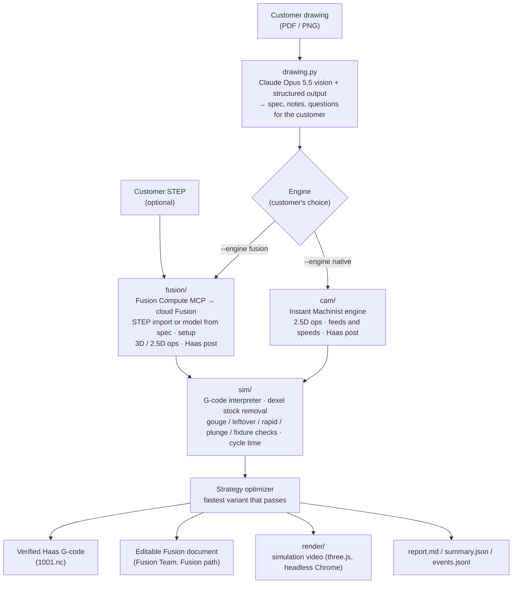

# Architecture



One command runs the whole flow ([`pipeline.py`](../instant_machinist/pipeline.py)):

```bash
python -m instant_machinist.pipeline --part parts/ftc-10 --engine fusion --out out/<job>            # STEP + drawing
python -m instant_machinist.pipeline --part parts/sm-101 --engine fusion|native --out out/<job>     # 2.5D drawing
# [--no-read] [--no-video]
```

## Modules

| Module | Responsibility | Key entry points |
|---|---|---|
| `pipeline.py` | Orchestrates one job: read → STEP import or model → program variants → verify each → pick best → save Fusion file → render video → `summary.json`. Holds the pass rule: complete jobs pass every check, an OP1 of a multi-setup part passes the `SAFETY` checks (gouge, rapid into stock, fixture, flute length) and reports leftover as next-setup work | `run(part, out, engine, read, video)`, `passed()`, `SAFETY` |
| `events.py` | Appends every step to `out/<job>/events.jsonl` with elapsed seconds (feeds the UI and the timing numbers) | `Events.emit(step, msg, **data)` |
| `drawing.py` | Sends the PDF or image to **Claude Opus 5.5** (`claude-opus-5-5`, adaptive thinking, medium effort) with a Pydantic schema through `messages.parse`. Returns a `Spec`: part number, material, quantity, tolerance, finish, features, notes for the machinist, questions for the customer. `normalize()` fills hole depths the drawing implies ("THRU", holes on a pocket floor). `compare()` diffs the result against a reference spec. | `read_drawing`, `normalize`, `compare` |
| `fusion/` | Path A: drives Autodesk Fusion in the cloud through the Fusion Compute MCP: STEP import and orientation, or model from spec; 3D or 2.5D CAM; post; save. See [FUSION-COMPUTE.md](FUSION-COMPUTE.md). | `FusionProgrammer.import_step/model/program3d/program/save` |
| `cam/` | Path B: our own 2.5D CAM engine (below) | `python -m instant_machinist.cam.run` |
| `sim/` | Simulator / verifier. See [VERIFIER.md](VERIFIER.md). | `sim.run.simulate`, `python -m instant_machinist.sim.run` |
| `render/` | Simulation video and hero stills from simulator output (below) | `python -m instant_machinist.render.video` |
| `parts/` (package) | Demo part generator for 2.5D parts: `features.json` → STEP, STL, 2D drawing PNG/PDF, preview (cadquery + trimesh + matplotlib) | `python -m instant_machinist.parts.build_part parts/sm-101` |

## Demo parts

| Part | Input | Program | Target for the verifier |
|---|---|---|---|
| `parts/ftc-10/` (headline) | NIST FTC-10 STEP (`source-yup.stp`, imported by URL) + 5-page GD&T drawing; `features.json` holds the stock, part box, setup, STEP URL and orientation | OP1 top side, Fusion path | `part.stl`, derived from the STEP and oriented like the setup (`target: stl`) |
| `parts/sm-101/` | Drawing (generated from `features.json` by `instant_machinist/parts/`) | Complete job, one setup, both engines | `features.json` |

## Conventions and contracts

All units are mm. The part origin is the top centre of the finished part: Z = 0 is the finished top
face and Z is negative going down. Simulator outputs (`frames.npz`, `toolpath.npz`, `report.json`)
and the accepted G-code dialect are specified in [CONTRACTS.md](CONTRACTS.md). Both engines emit the
same Haas-style ISO G-code, and the simulator accepts all of it.

Per part (`parts/<id>/`): `features.json` (2.5D features: face, profile, pocket, hole; plus stock and
part boxes), `tools.json` (tool crib by T number: type, diameter, flutes, flute length, tip angle),
`drawing.pdf`/`.png`, `part.step`, `part.stl`.

## Instant Machinist engine (`cam/`)

| File | What it does |
|---|---|
| `plan.py` | Plans one top setup. **Facing** zigzag with the face mill. **Profile roughing** with offset passes and **pocket roughing** with inward offset rings, helix entry (ramp entry for narrow slots), 0.2 mm left for finishing. **Finishing** of floors and walls with quarter-arc **lead-in/out**. **Spot drilling** (G81) and **peck drilling** (G83). Tools come from the crib: the largest flat end mill whose radius fits the pocket corner radius and whose flutes reach the depth, and a drill that matches each hole. |
| `feeds.py` | Feeds and speeds for 6061-T6 with carbide tools: surface speed and chipload by tool type and diameter, **radial chip thinning** at light engagement, a 0.6× slotting factor, all clamped to a **Haas VF-2** (8,100 rpm, 16,500 mm/min). |
| `geom.py`, `toolpath.py` | Rounded-rectangle offsets, arcs, swept areas; move builder (rapid / feed / arc / helix / ramp / canned cycle) and a native time estimate. |
| `post_haas.py` | Haas post: program header with stock and WCS comments, `T M6`, `G43 H`, `S M3`, `M8`, arcs as I/J, `G83 Q` cycles, `G28` returns, `M30`. |
| `gparse.py` | Strict mini-parser. Every posted program must pass it before it is written. |
| `optimize.py` | **Strategy optimizer.** Builds 8 variants: light-engagement offset roughing with chip-thinning feeds at 25 / 35 / 45 % stepover × 1D / 2D depth, and conventional 50 % / 0.5D and 60 % / 1D. Scores each with the simulator's cycle model, then runs the full simulator checks from the fastest down. The first one that passes wins. Also builds the cautious manual baseline (10 % stepover, 0.5D, 60 % feeds). |
| `run.py` | CLI: writes `native/1001.nc`, `native/ops.json`, `native/variants.json`, `baseline/…`. |

On SM-101 the engine plans 10 operations with 6 tools and picks the 3:07 program. Planning, posting,
scoring and verification of all 8 variants plus the baseline take 2.7 s.

## Fusion path (`fusion/`)

For a STEP part, `FusionProgrammer.import_step(url, rot_x)` starts a cloud Fusion session, has Fusion
import the STEP from its URL, and orients it Z-up with the top centre at the origin (`importstep.ts`).
`program3d(strategy)` then builds OP1 (`cam3d.ts`) and generates it one operation at a time.

For a 2.5D part without a STEP, `model()` builds the parametric model from the spec (`model.ts`) and
`program(strategy)` runs `cam.ts`.

Either way, the strategy is injected as JSON, Haas G-code is posted, and the tool table is exported
so our simulator uses Fusion's real tool geometry. The pipeline runs a cautious baseline plus 4
adaptive variants (`strategies.py`), verifies each, then re-programs the winner and saves the
document. Details and gotchas: [FUSION-COMPUTE.md](FUSION-COMPUTE.md).

## Renderer (`render/`)

`render/video.py` turns `frames.npz` and `toolpath.npz` into a 1920×1080 H.264 video or a single PNG
still (`--still`):

1. **Data prep** (Python): resamples the stock heightmap per frame (`--mesh-cells`, default 440 along
   the long side), maps frames to toolpath moves, resolves tool labels from `tools.json`, adds intro and
   final-beat frames, and writes `meta.json`, `heights.bin` and `masks.bin` (gouge and leftover cells).
2. **Scene** (`web/scene.js`, three.js, vendored, no CDN): the stock as a lit height field, the cutter
   by type and diameter, a glowing toolpath trail (`--trail-mm`), a camera move, and a HUD with tool,
   operation, progress and machine-time clock. The final beat fades the trail and shows the badge,
   e.g. `Verified: 0 gouges · 6:28 cycle`. `window.renderFrame(i)` is deterministic, so frames can be
   rendered in any order.
3. **Capture** (`web/render.mjs`): headless Chromium through Playwright serves the page and data from
   a local static server, renders frame ranges with parallel workers to PNG, and `ffmpeg` encodes
   (`libx264`, CRF 18, `+faststart`).
4. **Split rendering** (`--drun N`): renders N frame ranges in parallel Daytona sandboxes through the
   `drun` CLI. Each sandbox encodes its own segment, and the segments are joined locally with `ffmpeg
   -f concat -c copy`.

Requirements: `node`, the `playwright` npm package with Chromium (local or global), and `ffmpeg`. Tests
(`tests/render/`) cover data prep against the contract with synthetic frames (`render/fake_frames.py`).

## Outputs of a job

```
out/<job>/
  events.jsonl            timeline of every step (seconds since start)
  spec.json               the machining spec used (from the drawing read, cross-checked)
  summary.json            programming time, baseline, best, all variants, % machine time saved
  simulation.mp4          video of the winning program (when rendered)
  fusion/<strategy>/      Fusion path: 1001.nc, tools.json, ops.json, sim/
  native/{native,baseline}/  native path: 1001.nc, ops.json, variants.json, sim/
     sim/report.md|json, final_maps.png, frames.npz, toolpath.npz
```

## Drawing read

For a STEP part (FTC-10) the geometry comes from the STEP. Claude's drawing read supplies what the
model doesn't carry: tolerances, GD&T, notes and questions for the customer. On FTC-10's 5-page
drawing it returned 25 machining notes and 8 questions in 28.5 s. Those cover the missing material and
stock size, the missing quantity and finish, an `M3x0.5-6g` external-thread class applied to holes,
approval of multiple setups, the edge break, and one unclear tolerance frame.

For a 2.5D part without a STEP (SM-101), the pipeline compares Claude's spec with the part's reference `features.json`. A match is exact
geometry: every feature's type, rectangle, diameter, bottom Z and hole positions to 0.01 mm. If they
match, the read spec (with Claude's part name, notes and questions) drives programming. If they don't,
the differences go to the event log and programming uses the reference spec. In the canonical run
(`out/run2`) the read matched exactly in 22 s. Claude also returned 12 machinist notes and 4 questions
for the customer, for example whether the "40 × 8" slot length is overall or centre-to-centre.
