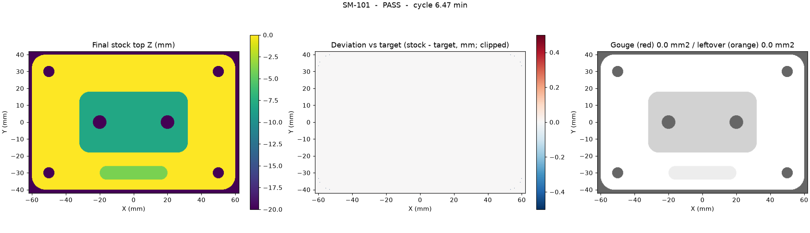

# Simulator / verifier

Every program, whether Autodesk Fusion or our own engine wrote it, runs through our simulator
before anyone sees it. The simulator removes stock move by move and checks the result against the
finished part. It reports each problem with the **NC line**, the **block text**, the **tool** and the
**X/Y location**, and gives a cycle time for every program. The strategy optimizer only offers
programs that pass.

Code: [`instant_machinist/sim/`](../instant_machinist/sim). CLI:

```bash
.venv/bin/python -m instant_machinist.sim.run --part parts/sm-101 --nc out/<job>/1001.nc \
    --tools out/<job>/tools.json --out out/<job>/sim [--frames 360]
```

## Pipeline

| Stage | Module | What it does |
|---|---|---|
| Parse | `sim/gcode.py` | Haas-style ISO interpreter: G0/G1/G2/G3 (I/J/K or R, G17/G18/G19 planes, helical), G4, G20/G21, G28, G52 local offsets, G53, G54–G59, G90/G91, G90.1/G91.1, G43/G49, canned cycles G73/G81/G82/G83/G84/G85/G86/G89 + G80 with G98/G99, T/M6, S, F, M codes, comments, N numbers, O, `%`. Arcs become chords within **0.01 mm**; canned cycles become their real pecks and retracts (Haas setting 22 clearance). Several programs (setups) can run in order. |
| Stock | `sim/stock.py` | Heightmap stock (one Z dexel per cell, **0.25 mm** cells: 496 × 336 cells for the 124 × 84 mm SM-101 blank, 648 × 316 for the 162 × 79 mm FTC-10 blank). Vectorised tool sweeps for flat, face, bull, ball, drill and spot-drill tools, using each tool's real tip profile. |
| Target | `sim/target.py` | The finished part as two maps: `top` (what must remain) and `floor` (the lowest Z the tool may reach). Built from `features.json` (2.5D parts) or from the part mesh via trimesh (STEP parts such as FTC-10, `target: stl`). A test checks the two sources agree in ≥ 99.8 % of cells on SM-101. |
| Checks | `sim/checks.py` | Runs during the sweep and on the final stock (below). |
| Cycle time | `sim/cycle.py` | Feed moves at the programmed F over path length. Rapids at 25,000 mm/min per axis (Haas VF-2 class), timed by the slowest axis. 4 s per tool change. Dwells as programmed. |
| Report | `sim/run.py` | `report.json` + `report.md`, `final_maps.png` (final stock, deviation, gouge/leftover map), `frames.npz` + `toolpath.npz` renderer ([contract](CONTRACTS.md)). |

## Checks

| Check | Fails when | Tolerance |
|---|---|---|
| **Gouge** | Stock is cut below the finished part (target floor) | 0.02 mm |
| **Leftover** | Stock is left above the finished surface | Drawing general tolerance (0.1 mm for SM-101); fails at ≥ 0.5 mm² total area |
| **Rapid into stock** | A G0 move removes material | > 0.01 mm removed |
| **Flat end mill plunge** | A flat or face mill feeds straight down into solid material | > 0.5 mm deep |
| **Below fixture / vise** | The tool enters the vise jaws (bottom 6 mm of the blank on the ±Y faces) or goes below the blank bottom over the part | Geometric, with tool radius |
| Flute length (warning) | Axial engagement is deeper than the tool's flute length | 0.05 mm |

Gouge and leftover use a one-cell (0.25 mm) XY tolerance band at walls. Without it, a wall that lands
exactly on the drawing line would show up as noise. Gouge and leftover areas are grouped into
connected regions. Each region reports its area, its maximum depth or excess, the drawing feature it
sits on, and, for gouges, the first NC line that cut it.

## Pass rules

| Program | Must pass | Reported, not failed |
|---|---|---|
| A complete job in one setup (SM-101) | All checks: gouge, leftover, rapid into stock, flat plunge, fixture, flute length | – |
| OP1 of a multi-setup part (FTC-10) | **Safety checks**: gouge, rapid into stock, fixture, flute length | Leftover stock: the later setups' work, listed region by region with location and height. Short flat-end-mill plunges, flagged for review |

The rule lives in `SAFETY` and `passed()` in [`pipeline.py`](../instant_machinist/pipeline.py). Every
check runs on every program either way, and the report always lists all of them.

## FTC-10: OP1 of a multi-setup part

The NIST FTC-10 housing has features on the top, the bottom and the sides. OP1 machines the top side
from the customer's STEP. The target is the STEP-derived mesh `parts/ftc-10/part.stl`, oriented like
the Fusion setup. Results from run `out/run3` ([`results/ftc-10/`](results/ftc-10)):

| Program | Cycle | Gouges | Rapids into stock | Fixture | Flute length | Flagged for review | Verdict |
|---|---|---|---|---|---|---|---|
| Typical manual program (3D pocketing, book feeds) | 1:49:46 | 0 | **6** | OK | OK | 4 short plunges | **Fail** |
| Adaptive 1.5 mm load, 12 mm steps | 38:14 | 0 | 0 | OK | OK | 3 short plunges | Pass |
| Adaptive 2.5 mm load, 12 mm steps | 34:30 | 0 | 0 | OK | OK | 3 short plunges | Pass |
| Adaptive 2.5 mm load, 24 mm steps | 30:00 | 0 | 0 | OK | OK | 3 short plunges | Pass |
| **Adaptive 3.0 mm load, 24 mm steps (chosen)** | **26:42** | **0** | **0** | **OK** | **OK** | 3 short plunges | **Pass** |

**Baseline failure.** The 6 mm end mill's wall-finish pass rapids (G0) into stock six times near
X28 Y38. The first is block `N78860 G0 Z-4.046` at 0.25 mm deep, the last `N88705 G0 Z-6.5` at
2.7 mm deep. Each toolpath is valid on its own. The collision appears only against the stock the
earlier operations really left, and our simulator tracks that stock move by move. (Fusion's
in-process stock is not available in Design Automation.)

**Winner, flagged items.** Three 6 mm end mill plunges go 0.59–0.60 mm into material at F750
(`N46460 Z-4.9 F750.`, `N63470 Z-23.4 F750.`, `N79145 Z-23.4 F750.`). They are listed with NC line
and X/Y for the programmer's review.

**Stock for later setups.** At the end of OP1, 469 mm² of the top view (about 4 % of the
158 × 75 mm footprint, in 61 regions) sits above the model. That includes the holes on the three pads and the oval boss (Ø3.5, M3) and detail
that the next setups' tools machine. Each region
is in the report with its X/Y, target Z and stock Z.


## Speed

| Program | Segments after arc/cycle expansion | Verify time |
|---|---|---|
| SM-101 typical manual program (Fusion, out/run2) | 13,930 | 1.44 s |
| SM-101 adaptive 3.0 mm load / 20 mm steps (Fusion, best) | 15,326 | 2.69 s |
| SM-101 adaptive 1.5 mm load / 10 mm steps (Fusion) | 19,805 | 1.50 s |
| SM-101 native engine best | 1,225 | 0.48 s |
| **FTC-10 OP1** (out/run3), 5 Fusion programs | 83,630 – 125,928 | 21 – 38 s each |

Verification takes seconds on 2.5D parts and well under a minute on FTC-10's 3D programs, so the optimizer verifies every strategy variant.

## Example: what the verifier caught in Fusion's first SM-101 program

The first program Fusion posted for SM-101 looked normal: valid toolpaths, no errors from Fusion, and a
plausible 8:37 cycle. The verifier failed it:


Excerpt of the report ([full report](examples/sm-101-fusion-first-program.report.md); program in
[`examples/sm-101-fusion-first-program.nc`](examples/sm-101-fusion-first-program.nc)):

```
FAIL  cycle 8.62 min  gouge=FAIL  leftover=FAIL  rapid_into_stock=ok  flat_plunge=FAIL  below_fixture=ok

| Gouge                           | FAIL | 2189.75 mm2, max 8.0 mm deep            |
| Leftover above tolerance        | FAIL | 2265.25 mm2 in 2 regions, max 4.0 mm    |
| Flat end mill plunge into solid | FAIL | 1 events                                |

### Gouge
- line 7601 `N37935 Z-7.` (T2) at X-27.88 Y-27.88 {"area_mm2": 2189.75, "max_depth_mm": 8.0, "z": -8.0, "feature": "F1"}
### Leftover above tolerance
- at X-26.88 Y-17.62 {"area_mm2": 2121.5, "max_excess_mm": 0.2, "feature": "F3", "target_z": -8.0, "stock_z": -7.8}
- at X-14.12 Y-33.62 {"area_mm2": 143.75, "max_excess_mm": 4.0, "feature": "F4", "target_z": -4.0, "stock_z": 0.0}
### Flat end mill plunge into solid
- line 7601 `N37935 Z-7.` (T2) at X-27.0 Y26.0 {"z": -7.0, "depth_into_material": 7.0}
```

What happened, defect by defect:

| Defect | Evidence in the program | Root cause | Fix in [`fusion/ts/cam.ts`](../instant_machinist/fusion/ts/cam.ts) |
|---|---|---|---|
| **Pocket wall finish ran on the wrong side of the wall.** It cut an 8 mm deep ring around the 64 × 36 pocket into the top face (2,190 mm²) and plunged the 10 mm end mill 7 mm into solid stock. | Line 7601 `N37935 Z-7.`: the "Finish pocket walls" contour runs at X±37 / Y±23 with a Ø10 tool, so it cuts out to X±42, but the walls are at X±32 / Y±18. | The contour chain came from the pocket floor's outer loop. Fusion's default side for that chain direction is outside. | Reverse the chain (`isReverted = true`) so the tool stays inside the pocket. |
| **0.2 mm left on the pocket floor** (2,122 mm² at Z−7.8 instead of Z−8). | Leftover region on feature F3. | Roughing kept a 0.2 mm finishing allowance. Its vertical (floor) stock to leave was never set, and no later operation finished the floor. | Set `verticalStockToLeave: 0 mm` explicitly on roughing. Walls keep 0.2 mm for the finish pass. |
| **Slot 7 mm wide instead of 8, 3.5 mm deep instead of 4.** | T3 (Ø6) cuts between Y−30.5 and Y−29.5 (swept width 7 mm), ZMIN −3.5. | The slot operation set stock to leave through parameter names Fusion does not have (`axialStockToLeave`, `finishingStockToLeave`). They were never applied. | Use Fusion's real parameters: `stockToLeave: 0 mm` and `verticalStockToLeave: 0 mm`. |

After the fix, the same part re-programmed in Fusion passes every check in all five strategy variants
(out/run2). The slot now runs between Y−31 and Y−29 at Z−4, so the Ø6 tool cuts the full 8 mm width
to full depth:



Reproduce the failing report: `make verify-example`.

## Test coverage

`tests/sim/` (run in CI):

- Arcs: I/J/K and R forms, CW/CCW, full circles, G18 lead-ins, 0.01 mm chord tolerance; inch and
  incremental modes; G53/G28 tool changes; G81/G82/G83/G73 expansion with G98/G99 retracts.
- A small part with a deliberate 3 mm gouge: the gouge is found on the right NC line (28) and location.
- One program with a straight flat-end-mill plunge, a rapid into stock and a move into the vise jaw:
  each is reported on its own NC line. A diagonal move that crosses a jaw between two safe end points
  is caught too.
- A hand-written SM-101 program passes in under 60 s with 360 video frames.
- The STL-derived target matches the feature-derived target.
